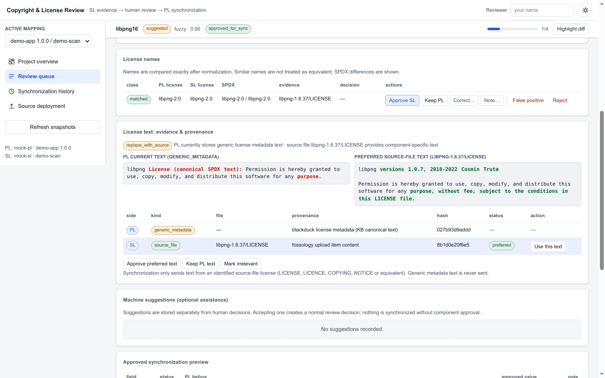

# CL Review — Copyright & License Data Review Platform

[](https://github.com/dineshr93/cl-review-platform/actions/workflows/ci.yml)
[](https://github.com/dineshr93/cl-review-platform/actions/workflows/release.yml)
[](LICENSE)
[](pyproject.toml)

Tool-agnostic review platform for copyright and license data. Source-level (SL) scanners provide
evidence; a human validates it; only explicitly approved corrections are written to the
project-level (PL) tool. Synchronization is **one-way, SL → PL**, never reverse.

```
PL tool (Black Duck / FOSSID)          SL tool (FOSSology / ScanCode)
        │  read components                     │  read components, copyrights, licenses, license files
        └──────────────┬───────────────────────┘
                       ▼
        snapshot → match → compare → human decision → preview → dry-run → write → verify → audit
```

Raw observations are stored separately from normalized comparison values and from approved values.
Refreshing a snapshot never erases a review decision; if source data changes after review, the
decision is flagged **stale** and must be re-reviewed before it can be synchronized.



*The component workspace: a sticky context bar with decision progress, word-level diff between the
PL and SL values, and a decision-button hierarchy that puts the safe action first and the
destructive ones behind a divider.*

## Requirements

| You need | For |
|---|---|
| Python 3.10+ (standard library only) | the server, the demo, and the whole test suite |
| Node 18+ and Chromium | only `tests/web_smoke.mjs`, the browser gate |

That is all. No build step, no database server, no JS framework, no `npm install` — the console is
zero-build vanilla JS/CSS served by the Python server itself.

## Install — pick one

### A. Zero-dependency demo

**Choose this when:** you want to see the whole review loop before deciding anything.

```bash
git clone https://github.com/dineshr93/cl-review-platform && cd cl-review-platform
python3 -m clreview.server --demo
# open http://127.0.0.1:8765
```

`--demo` seeds two mock connections (a project-level and a source-level tool), one project
mapping, and a realistic fixture set: identical components, a fuzzy match suggestion, unmatched
components on both sides, a copyright formatting variant, a license detected only in SL, a
generic license text in PL versus an original `LICENSE` file in SL, and a false-positive license.

### B. Install as a package

**Choose this when:** you are running this for real on a host that has Python.

```bash
python3 -m pip install cl_review_platform-1.0.0-py3-none-any.whl   # wheel from Releases
# or, from the source tree
python3 -m pip install .

clreview-server --db /var/lib/clreview/review.db --port 8765
```

`clreview-server` and `python3 -m clreview.server` are the same entry point.

### C. Docker

**Choose this when:** you want the container, a named volume, and a token.

```bash
docker build -t cl-review-platform .
docker run --rm -p 127.0.0.1:8765:8765 -v clreview-data:/data \
  -e CLREVIEW_TOKEN=change-me cl-review-platform
# or
docker compose up --build
```

The image runs as a non-root user, persists SQLite in `/data`, and exposes a `/api/health`
healthcheck. `docker-compose.yml` binds the port to loopback by default.

### The same tasks, four ways

| Task | `make` | `uv run` | plain `python3` / `node` |
|---|---|---|---|
| demo server | `make demo` | `uv run python -m clreview.server --demo` | `python3 -m clreview.server --demo` |
| test suite | `make test` | `uv run pytest -q --ignore=adws` | `python3 -m unittest discover -s tests -t tests` |
| lint | `make lint` | `uv run ruff check clreview tests` | — (ruff is a dev dependency) |
| stop the server | `make stop` | — | — |
| browser gate | — | `node tests/web_smoke.mjs` | `node tests/web_smoke.mjs` |
| print version | — | — | `python3 -m clreview.server --version` |

`make stop` targets a port: `make stop PORT=9000`. `make` creates `.venv` with `uv sync` on first
use; the plain-`python3` column needs nothing.

One honest note about `just`: the `justfile` in this repo drives the **SSSF agent tooling** in
`adws/` (`just scout "..."`, `just sdlc "..."`), not the application. There is no `just demo`.

## Your first review, start to finish

The demo fixture is arranged so a first-time reader reaches a real synchronization in one pass.

1. **Open the queue.** `http://127.0.0.1:8765` → **Review queue**.
2. **Open the fuzzy pair.** `libpng16 1.6.37` (PL) matched `libpng 1.6.37` (SL) by name
   similarity only — confidence below 0.70, so nothing merged automatically. The workspace shows
   the match evidence and the mismatch reasons side by side.
3. **Decide field by field.** Copyright notices, license names, and license text each get their own
   decision. Changed words are marked inline: green for what SL adds, struck through for what PL
   holds. Approve SL where the source is right, keep PL where it isn't, use **Correct…** to write
   your own value.
4. **Note what you decided and why.** Notes are recorded with your reviewer identity.
5. **Approve the component.** *Approve component for synchronization* moves it to
   `approved_for_sync`. Until then the component is invisible to the sync engine.
6. **Preview the writes.** **Synchronization history** → **Dry run**. Nothing is written; the
   report lists every field, its current PL value, and the value that would be written.
7. **Tick *I approve these writes*, then Execute.** The tick is required on a live job and is
   re-required whenever the change set changes.
8. **Read the report.** Per component: API status, verification result, and whether the write was
   applied, skipped as already applied, or refused as unsupported.

Press `?` anywhere for the keyboard shortcuts. `j`/`k` move the row cursor, `a` approves SL,
`p` keeps PL. The destructive actions — **Reject** and **False positive** — are deliberately
unbound; they take a deliberate click.

## Production deployment

- Bind to loopback behind a TLS reverse proxy, or set `CLREVIEW_TOKEN` and send
  `Authorization: Bearer <token>`. The server refuses nothing, but it warns loudly when bound
  beyond loopback without a token.
- Put reviewer identity in `X-Reviewer` (validated and recorded on decisions, notes, audit).
- Persist the database on a volume and back it up (SQLite file plus `-wal`/`-shm` while stopped, or
  use `sqlite3 .backup`). One server process per database file.
- Configure connections with credential **environment variable names**, not values. Rotate tokens
  by changing the environment; restart the server.
- Probe `/api/health` (public, returns DB status and version) from your orchestrator.
- Logs go to stderr (`--log-level debug|info|warning|error`); request lines contain no credentials.
- Shutdown is graceful on `SIGTERM`/`SIGINT`; the HTTP server stops accepting connections and closes
  the database.
- Keep the synchronization item cap (500 items per job) as a bulk-overwrite guard; live jobs still
  need `confirm=true` and a tested PL connection.

## Configuration

The server reads seven flags and five environment variables. A flag always wins over its
environment fallback; nothing else in the environment changes the server's behaviour.

| Flag | Environment fallback | Default | What it does |
|---|---|---|---|
| `--db` | `CLREVIEW_DB` | `clreview.db` | SQLite database path |
| `--host` | `CLREVIEW_HOST` | `127.0.0.1` | bind address |
| `--port` | `CLREVIEW_PORT` | `8765` | bind port |
| `--demo` | — | off | seed two mock connections, one mapping and the fixture set |
| `--fixtures` | — | packaged `clreview/fixtures/demo` | directory of fixture JSON used by `--demo` |
| `--log-level` | `CLREVIEW_LOG_LEVEL` | `info` | one of `debug`, `info`, `warning`, `error` |
| `--version` | — | — | print `clreview-server <version>` and exit |

`clreview-server` (installed wheel) and `python3 -m clreview.server` are the same entry point.

| Variable | Default | Effect |
|---|---|---|
| `CLREVIEW_DB` | `clreview.db` | database file; one server process per file |
| `CLREVIEW_HOST` | `127.0.0.1` | bind address |
| `CLREVIEW_PORT` | `8765` | bind port (the container healthcheck reads it too) |
| `CLREVIEW_LOG_LEVEL` | `info` | log verbosity on stderr |
| `CLREVIEW_TOKEN` | unset | shared bearer token; clients send `Authorization: Bearer <token>`. Binding outside `127.0.0.1`/`localhost`/`::1` without it logs `binding to <host> without CLREVIEW_TOKEN: the API is unauthenticated` — that warning is the reason to set it. |

Load a file of them with `set -a` so every line is exported without naming each one:

```bash
cp .env.example .env      # edit the values
set -a; . ./.env; set +a
python3 -m clreview.server
```

### Environment names a connection points at

`BLACKDUCK_URL`, `BLACKDUCK_TOKEN`, `FOSSOLOGY_URL`, `FOSSOLOGY_TOKEN`, `FOSSOLOGY_USER`,
`FOSSOLOGY_PASS` and `SCANCODE_JSON` are **not** read by the server. No code in `clreview/` looks
them up by name. A connection stores the *name* of a variable in its `auth_env` map
(e.g. `{"token": "BLACKDUCK_TOKEN"}`) and the connector resolves that name at call time, so
exporting `BLACKDUCK_URL` on its own changes nothing: a tool's URL is the connection's `base_url`
field, entered when the connection is created. `.env.example` lists these names as a starting
point for the `auth_env` entries you will configure.

| Name | Connector reads it as |
|---|---|
| `BLACKDUCK_TOKEN` | Black Duck `auth_env.token` (bearer token) |
| `FOSSOLOGY_TOKEN` | FOSSology `auth_env.token` (bearer) |
| `FOSSOLOGY_USER` / `FOSSOLOGY_PASS` | FOSSology `auth_env.username` / `auth_env.password` (basic-auth fallback) |
| `SCANCODE_JSON` | ScanCode `auth_env.json_path` (or plain `config.json_path`) — path to a `--json-pp` file |

Two env files exist and they are not interchangeable: **`.env.example`** is this server's
environment (the five `CLREVIEW_*` settings plus the names above); **`.env.sample`** holds the
SSSF agent-roster keys (`OPENROUTER_API_KEY`, `FIREWORKS_API_KEY`, `PI_PATH`, …) for the agent
tooling in `adws/`. Neither reads the other.

### Limits fixed in code

| Limit | Value | Configurable |
|---|---|---|
| Synchronization items per job | 500 | only by constructing `SyncService(max_items=…)` — no env var, no connection key |
| Connector pagination pages per listing | 200 | no; a connector that keeps returning pages raises instead of looping |
| Request body size | 1 000 000 bytes | no |
| Snapshots kept per mapping side | 5 | no |
| `IN (…)` chunk size | 500 | no (stays under SQLite's host-parameter limit) |
| Review queue page size | `limit` default 50, capped at 200 | per request |
| Audit page size | `limit` default 100, capped at 500 | per request |

## Real integrations

Connections are configured in the UI (or via `POST /api/connections`). Credentials are **never**
stored in the database or returned by the API — only the name of the environment variable that
holds them. Copy `.env.example`, export the variables it names, then create the connections that
point at those names.

```bash
export BLACKDUCK_TOKEN=...            # Hub access token
export FOSSOLOGY_TOKEN=...            # FOSSology API token (or FOSSOLOGY_USER/FOSSOLOGY_PASS)
python3 -m clreview.server --db clreview.db
```

Only the tokens are environment variables. A tool's URL is not one: it is the connection's
**base URL** field, entered below.

Then in the UI:

1. **Add connection** — role `pl`, tool `blackduck`, base URL, token env `BLACKDUCK_TOKEN`.
2. **Add connection** — role `sl`, tool `fossology`, base URL, token env `FOSSOLOGY_TOKEN`.
3. **Test** each connection (synchronization stays disabled for a PL connection that has not
   passed a connectivity test).
4. **Create mapping** — choose PL project/version and the SL upload/scan.
5. **Refresh snapshots** and review.

Example request/response shapes for connections and mappings live in `config.example.json`. It is
an illustration of the JSON bodies, not a file the server loads — configuration is the CLI, the
environment, and `POST /api/connections`. The API is documented in
[docs/CONNECTORS.md](docs/CONNECTORS.md).

## Closing the loop: BOM → sources → review → back

The pattern this platform sits between is a round trip, not a one-way sync:

```
Black Duck project version ──BOM──▶ id2url ──source URLs──▶ FOSSology folder
        ▲                                                        │
        └── controlled sync ◀── review decisions ◀── agent findings
```

`POST /api/deploy` performs the outbound half: it reads the BOM, resolves every registry origin to
a download URL with [`id2url`](https://github.com/dineshr93/id2url), creates the FOSSology folder
`{project}__{version}` (or a custom name) and uploads one archive per library. It is a dry run
unless `dry_run: false`, and it reports per component — `uploaded`, `already_present`,
`no_source_url`, `unsupported_registry`, `upload_failed`, `would_upload` — never a blanket ok.
The folder then appears in the mapping picker as a scan, so the same review and sync path applies.

The same flow has a UI: **Source deployment** in the sidebar. Pick the project-level tool, project,
version, parent folder and an optional folder name, then **Preview sources** — which writes nothing
and lists what each library resolved to. **Upload to scanner** stays disabled until a preview matches
the target *and* you tick the approval box; changing any field invalidates the preview again. After a
live run the report offers **Create mapping from this folder**, which wires the deployed folder to
that project version so review and sync work starts immediately.

id2url is AGPL-3.0, so it runs as a **subprocess**, never as a dependency. Put `id2url` on the
server's PATH (`uv pip install id2url`) or point at it with the connection config
`id2url_command`. Registries it covers: maven, npm, pypi, crates, nuget, rubygems, go, packagist,
cocoapods, hex, pub.

## What the reviewer gets

- **Project overview**: connection health, retrieval timestamps and errors, component/match
  counts, pending review, approved-for-sync, stale approvals, recent sync jobs. Every count is a
  link that opens the queue pre-filtered to exactly those components
  (`#/queue?review_status=approved_for_sync`).
- **Review queue**: search by component name, version, or license; filter by match status,
  confidence, review status; sort by name/confidence/discrepancies; paginated. Search filters as
  you type (debounced 250 ms) and the filters live in the URL, so a queue state is a link you can
  paste into a ticket.
- **Component workspace**: PL and SL identity with match evidence and mismatch reasons,
  side-by-side copyright notices, side-by-side license names with SPDX and evidence paths,
  license text viewer with provenance (generic metadata vs original source file), per-entry
  decisions, notes, stale-approval warnings, approved synchronization preview. A sticky context
  bar keeps the component name, match badge and decided/total progress visible while you scroll a
  long comparison; word-level diff marks what changed instead of making you compare two blocks by
  eye. Decision buttons are ranked, not equal: *Approve SL* is primary, *Keep PL* secondary,
  *Correct…* and *Note…* ghost, and the destructive pair sits behind a divider.
- **Synchronization history**: dry-run and live jobs, before/after values, API status,
  verification result, per-component report, retry of failed items, audit trail.
- **Keyboard triage**: `/` focuses search, `j`/`k` move the row cursor, `Enter`/`o` open it,
  `a` approves SL, `p` keeps PL, `e` opens Correct, `n` focuses the note box, `?` lists them,
  `Esc` closes a dialog. Keys are suppressed while you are typing or a dialog is open, and no
  destructive action has a key.
- **Theming**: light and dark, following `prefers-color-scheme` on first load and remembering your
  choice. Motion respects `prefers-reduced-motion` by removing travel, not feedback. Coarse
  pointers get larger hit targets.

## Review lifecycle

Review status is computed per component from field-level decisions:

`not_reviewed` → `review_required` → `in_progress` → `reviewed` → `approved_for_sync`

Synchronization status is tracked separately per job and per item:

`pending` → `dry_run` / `in_progress` → `synchronized` | `failed` | `skipped` | `unsupported`

Item statuses: `ready`, `already_applied`, `unsupported_target`, `conflict`, `stale`,
`succeeded`, `failed`, `skipped_already_applied`.

## Matching

Hierarchy, with confidence and rationale recorded for every proposal:

1. identical normalized purl — 0.99
2. identical normalized name + version — 0.95
3. shared strong identifier — 0.90
4. name match with a version missing on one side — 0.72
5. name match with the versions agreeing, when the stronger rules did not fire — 0.72
6. fuzzy name similarity (≥ 0.72) — **suggestion only**, confidence < 0.70, requires confirmation

Weak fuzzy matches never merge components automatically. Unmatched components stay visible on
both sides and can be manually assigned, confirmed, or rejected. Rejections survive refreshes.

## License text provenance

PL text is classified as `generic_metadata` (canonical KB text) or `source_file` (component-specific).
SL generic metadata (`/license/{shortName}`) is labelled as metadata and is **never** sent to PL.
Only text read from an identified license file in the source tree (`LICENSE`, `LICENCE`, `LICENSE.txt`,
`COPYING`, `COPYING.LESSER`, `NOTICE`, case/extension variants, and equivalents discovered in the tree)
can be approved for synchronization. If no reliable source text exists, the component is flagged
for further review — no text is invented or reconstructed.

## Synchronization rules

- Only decisions with an explicit approval (`approve_sl` / `correct`) on a component that is
  `approved_for_sync` are candidates.
- Live writes require `confirm=true`, a verified PL connection, and stay below the item cap
  (500 per job) as bulk-overwrite protection.
- Each item is validated against the connector's declared capability; unsupported fields are
  reported as `unsupported_target` with the reason, never reported as success.
- Every write records the API status/response and is verified by re-reading PL where the API allows it.
- Re-running is idempotent: values already present are `skipped_already_applied`.
- Decisions made against older source versions are `stale`; PL values that changed after review are
  `conflict`; neither is written.

## API

| Method | Path | Purpose |
|---|---|---|
| GET | `/api/health` | liveness |
| GET | `/api/tools` | connector catalog and supported roles |
| GET | `/api/version` | product name and version |
| GET/POST | `/api/connections` | list/create connections |
| POST | `/api/connections/{id}/test` | connectivity test |
| GET | `/api/connections/{id}/projects` | PL project + version discovery |
| GET | `/api/connections/{id}/scans` | SL scan discovery |
| GET | `/api/connections/{id}/folders` | FOSSology folders (selectable as `folder:<id>` scans) |
| GET/POST | `/api/mappings` | list/create PL↔SL mappings |
| GET | `/api/mappings/{id}` | one mapping |
| POST | `/api/mappings/{id}/refresh` | retrieve both sides, re-match, preserve decisions |
| GET | `/api/mappings/{id}/overview` | counts, side status, recent sync |
| GET | `/api/mappings/{id}/components` | queue (`q`, `status`, `review_status`, `confidence`, `sort`, `offset`, `limit`) |
| GET | `/api/components/{id}` | workspace detail |
| POST | `/api/components/{id}/decisions` | field-level decision |
| POST | `/api/components/{id}/notes` | reviewer note |
| POST | `/api/components/{id}/review` | review state transition |
| POST | `/api/components/{id}/confirm` / `reassign` / `reject` | match management |
| POST | `/api/components/{id}/suggestions` | record a machine suggestion |
| POST | `/api/suggestions/{id}/decision` | accept/reject a suggestion |
| POST | `/api/sync/preview` | approved-change preview |
| POST | `/api/sync/jobs` | dry-run or live job (`dry_run`, `confirm`, `component_ids`) |
| GET | `/api/sync/jobs` | recent jobs for a mapping (`mapping_id`, `limit`) |
| GET | `/api/sync/jobs/{id}` | per-component report |
| POST | `/api/sync/jobs/{id}/retry` | retry failed items |
| POST | `/api/deploy` | push a Black Duck BOM into a FOSSology folder via id2url (`dry_run` defaults to true) |
| GET | `/api/audit` | audit events |

Optional shared-token auth: set `CLREVIEW_TOKEN`; clients send `Authorization: Bearer <token>`.
The reviewer identity comes from `X-Reviewer` and is stored on decisions, notes, and audit events.

## Documentation

- [DESIGN.md](DESIGN.md) — the design system behind the console: tokens, components, and the
  rules the UI is held to.
- [docs/ARCHITECTURE.md](docs/ARCHITECTURE.md) — layers, domain model, data flow, statuses.
- [docs/CONNECTORS.md](docs/CONNECTORS.md) — connector contract, per-tool API mapping, adding a tool.
- [docs/API-CAPABILITIES.md](docs/API-CAPABILITIES.md) — audited Black Duck ⇄ FOSSology endpoint matrix
  and the Black Duck BOM → FOSSology folder flow.
- [docs/LIMITATIONS.md](docs/LIMITATIONS.md) — verified API limitations and how they are handled.
- [docs/ROADMAP.md](docs/ROADMAP.md) — FOSSID/ScanCode status, LLM assistance design.
- [SECURITY.md](SECURITY.md) — vulnerability reporting and deployment constraints.

## Releases

Tags matching `v*` trigger `.github/workflows/release.yml`, which builds the sdist and wheel,
verifies the wheel contents and entry point, writes `dist/SHA256SUMS.txt`, attests build provenance
for every artifact, and creates a GitHub release with generated notes and the artifacts. Manual
runs accept an existing tag. See [CHANGELOG.md](CHANGELOG.md).

## Testing

292 stdlib tests cover matching, comparison, review decisions, stale data, unsupported writes,
API failures and retries, idempotent re-sync, jobs interrupted by a crash mid-write, connector
error handling, credential hygiene, every error message the code raises, the escaping rules the
web assets depend on, and an end-to-end HTTP workflow against a mock PL. No production
credentials are needed.

```bash
make test                 # creates .venv via uv, then pytest with the 75% coverage gate
node tests/web_smoke.mjs  # the browser gate: one h1 per view, no overflow at 390px/320px,
                          # theme toggle in viewport, note counting, zero console errors
```

Two of those tests read this README. One asserts that the test count stated here equals the number
the suite actually discovers — **adding a test means updating the number above**. The other asserts
that every route in `api.ROUTES` appears in this page in backticks. Both are deliberate.

Three maintainer tools sit in `tools/`, outside the suite because they print observations for a
human rather than assert:

| Tool | What it answers |
|---|---|
| `node tools/capture_screenshots.mjs` | re-captures `docs/screenshots/*.png` from a throwaway demo server |
| `node tools/ui_check.mjs` | what the sticky bar, diff toggle, keyboard shortcuts and queue hash filters actually did in a real browser |
| `python3 tools/contrast_check.py` | whether every diff-paint, meter and `kbd` colour pair still clears WCAG AA |

## Screenshots

`docs/screenshots/` holds three captures of the running demo — project overview, review
workspace, and synchronization history — taken at 1440px. They are committed binaries,
deliberately, so this page renders without a running instance. Recapture them after a visible UI
change with:

```bash
CL_CHROME=/usr/bin/chromium-browser node tools/capture_screenshots.mjs
```

It boots its own throwaway `--demo` server on a free port, writes the three PNGs, and cleans up.
Review the images before committing them.

## Security posture

- Credentials only in environment variables; configs are sanitized before being returned.
- Read and write paths are separate connector methods; writes require explicit approval and confirmation.
- No success status until the target API operation succeeded and (where possible) was verified.
- Input validation on every write endpoint; bounded request bodies; no stack traces or tokens in responses.
- Every string the console renders goes through `CL.esc` before it reaches the DOM; scanner data is
  treated as hostile input, not as content.
- SQLite persistence; single-writer local deployment. For multi-user deployments, put the API behind
  an authenticating reverse proxy and use per-user reviewer identity.
